# StellarWeave — 星织

**Astronomical Image Processing · Crowded-field Stellar Detection · Reliable Photometry**

[](https://github.com/ZJY-HSBL/StellarWeave/actions/workflows/ci.yml) · [GitHub Releases](https://github.com/ZJY-HSBL/StellarWeave/releases)

**v0.16.0 research prototype / 科研原型。** This repository does NOT yet contain a trained neural network, science-grade PSF photometry, or independently validated absolute astrometry. It DOES include real ACSGGCT/HST internal astrometric consistency measurements and held-out native-pixel PSF shape comparisons across three globular clusters, with measured tables, source reports and reproducible plots below.

## Purpose / 研究目标

StellarWeave is designed to investigate faint stellar source detection, deblending, and measurement reliability in crowded telescope imagery. We are developing physically informed baselines, not merely applying YOLO to astronomy.

## v0.16.0 — Five-seed noise robustness: real HST mosaic backgrounds / 多随机种子噪声验证

**New actual observational benchmark: 2,520 additional noise-perturbed trials** from exactly **252 original v0.14 artificially planted star sites** in genuine STScI HST/ACS F606W mosaics. Each original site is held fixed and evaluated against *five predeclared independent random seeds* (11, 23, 37, 53, 71), using both (a) IID Gaussian and (b) spatially correlated Gaussian added noise. The two modes have identical per-pixel added RMS (half each original tile's robust pixel RMS). Source positions, fluxes, nontraining observed-star shape IDs, center/local templates and the original HST background are unchanged. **The 2,520 trials are not 2,520 independent astrophysical stars.**

### Five-seed real HST recovered planted-source fractions / 真实恢复率稳定性

Results below show **means of five within-seed recovery fractions** and observed min–max ranges across those same five random perturbation seeds. These **are descriptive seed ranges, NOT 95% confidence intervals or source-population completeness.**

| Actual HST cluster | Number of fixed injected sources | IID added Gaussian: mean (five-seed range) | Correlated added Gaussian: mean (five-seed range) |
|---|---:|---:|---:|
| NGC 6397 | 96 | **86.88%** (84.38–87.50%) | **84.79%** (82.29–88.54%) |
| NGC 6752 | 96 | **93.75%** (91.67–95.83%) | **94.17%** (91.67–95.83%) |
| **NGC 104 / 47 Tuc** | **60** | **89.33%** (88.33–91.67%) | **88.33%** (86.67–90.00%) |

The differences between the modes are **not monotonic across clusters**: NGC 6752 has a slightly higher observed mean in the correlated-noise repetitions, unlike NGC 6397 and NGC 104. This is an empirical finite-replicate result, not evidence that correlation improves detection. The original 252 fixed sites are **the same** as v0.14/v0.15, including the smaller number of isolated NGC 104 sites.

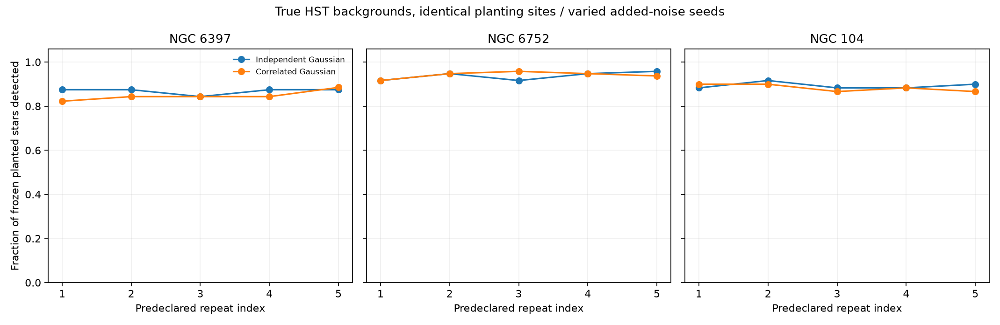

### Known-position forced local versus center PRF flux errors

Metric: **median of each seed's star-pooled median absolute relative flux-amplitude error**, using each injected star's known true pixel coordinate, so lower values indicate better *forced* amplitude fitting. These are not physically calibrated photometric flux errors, blind stellar measurements or independent-star confidence intervals.

| Observed cluster | IID: local / center | Correlated: local / center |
|---|---:|---:|
| NGC 6397 | 3.70% / 3.64% | 5.86% / 6.65% |
| NGC 6752 | **5.95% / 8.47%** | **8.70% / 9.48%** |
| **NGC 104** | **16.19% / 15.40%** | **16.51% / 15.90%** |

**Negative result retained:** on NGC 104, local PRF errors continue to exceed frozen-center errors under both repeated added-noise modes, although individual seed medians and paired per-source differences vary. NGC 6752 tends to favor its local PRF in this metric, illustrating why a single universal claim is not justified.

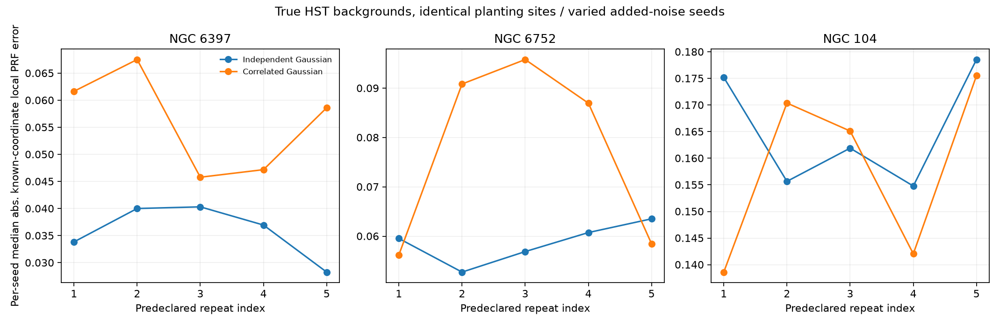

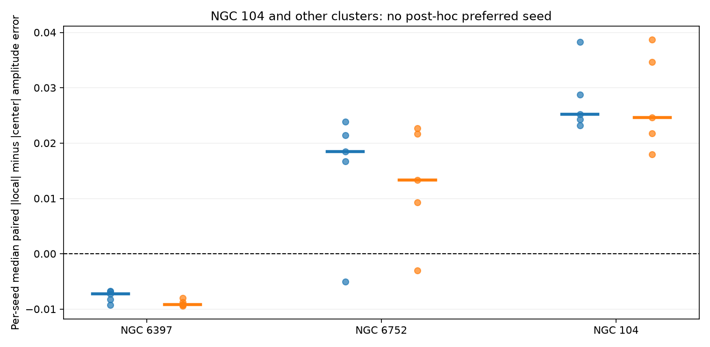

### Noise provenance and reproducibility / 数据完整性与噪声溯源

The real FITS science headers identify ACS/WFC and include **`BUNIT=ELECTRONS`, `CCDGAIN=1`** with `EXPTIME` values 15 s (NGC 6397), 35 s (NGC 6752) and 50 s (NGC 104). The selected images have **no same-sized ERR or DQ extension** in this data product. A reported BUNIT or CCDGAIN is **not sufficient** to infer the resampled mosaic's valid per-pixel independent electron-count distribution or Drizzle weight/covariance. Therefore **this release does not inject physical Poisson noise into the real FITS mosaics or claim instrument-calibrated error bars**. Both additions remain deterministic Gaussian stress controls on top of the existing telescope background.

The [committed v0.16 evidence folder](docs/results/real_noise_v16/) includes:

- [2,520 complete trial records](docs/results/real_noise_v16/per_trial.csv), including missed detections and any pre-existing added-noise peaks;
- [30 per-seed, per-cluster, per-mode summaries](docs/results/real_noise_v16/per_seed.csv), each computed over the same original planted sites;
- [240 tile-mode-seed noise field audits](docs/results/real_noise_v16/noise_audits.csv), showing added pixel RMS, horizontal lag-one correlation and all random generation seeds;
- [all three original HST-linked JSON reports](docs/results/real_noise_v16/source_reports/) and the [SHA-256 / GitHub Actions provenance summary](docs/results/real_noise_v16/summary.json).

Reproduce **all three README figures without downloading the original large FITS**:

```bash
python -m pip install -r requirements-smoke.txt
python -m stellarweave.noise_repeat_results \
  docs/results/real_noise_v16/source_reports/*.json \
  --out outputs/reproduced_v16_noise
```

To regenerate actual telescope experiments from official STScI downloads, see [Cross-region / Cross-cluster Astrometry CI](https://github.com/ZJY-HSBL/StellarWeave/actions/workflows/cross-region.yml): the full pipeline refits the original *non-injected* training-star PRFs, fixes all source identities and hashes, runs the complete 5×2×252 additional trials and republishes observed charts. Complete per-seed outcomes and failed injections are retained; a missing source, mutated source flux/shape, incorrect noise strength or inconsistent test-set membership triggers a hard validation error.

**Scope:** Five seeds reveal numerical sensitivity conditional on these planted sites, original HST backgrounds and chosen perturbation amplitude. They do **not** estimate physical detector noise covariance, stellar-population completeness, causal crowding effects, source Poisson shot noise, externally calibrated Gaia astrometry or instrument ePSF performance. STScI's Drizzle documentation discusses [pixel covariance and correlated noise](https://hst-docs.stsci.edu/drizzpac/chapter-3-description-of-the-drizzle-algorithm/3-3-weight-maps-and-correlated-noise); the artificial Gaussian spatial filter here is **not** a calibrated implementation of that covariance.
## v0.15.0 — Controlled noise robustness on real HST observations / 真实 HST 噪声压力实验

**This is a controlled sensitivity test on real HST/ACS F606W image backgrounds, NOT a physically calibrated noise or photometry model.** The original **252** v0.14 artificial-star positions, injection fluxes and *held-out observed HST star-shape templates* are frozen. Each original site is evaluated with (1) original background, (2) original + independent zero-mean Gaussian noise, or (3) original + spatially correlated zero-mean Gaussian noise. The two added-noise fields are normalized to the **same pixel RMS = 0.50 × original tile robust RMS**. Correlated noise is generated by Gaussian smoothing at 1.3 pixel sigma, not from inferred HST Drizzle covariance.

### Real three-cluster experiment: 756 paired trial records

| Real HST field | Original (v0.14) | + IID Gaussian | + Spatially correlated Gaussian |
|---|---:|---:|---:|
| NGC 6397 | 84/96 (**87.50%**) | 85/96 (**88.54%**) | 79/96 (**82.29%**) |
| NGC 6752 | 91/96 (**94.79%**) | 91/96 (**94.79%**) | 91/96 (**94.79%**) |
| NGC 104 (47 Tuc) | 54/60 (**90.00%**) | 53/60 (**88.33%**) | 52/60 (**86.67%**) |
| **Total** | **229/252 (90.87%)** | **229/252 (90.87%)** | **222/252 (88.10%)** |

The noise fields are independent deterministic stress realizations using seed 42 and per-tile fixed offsets. Across 24 peripheral HST tiles, median added one-pixel-lag horizontal correlation is **0.00057** (IID) versus **0.86169** (correlated); median added pixel RMS is **12.044 image units in both modes**. This correlation is a property of the ADDED synthetic field, NOT a measurement of HST's native pixel covariance. Six NGC 6397 correlated-mode injection sites developed pre-existing peaks in the noise-only baseline, so these are counted as ambiguous/nonrecovered rather than incorrectly called successful injections.

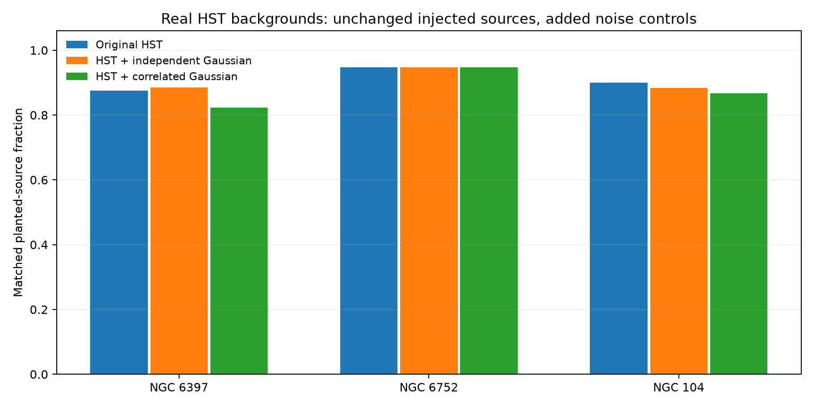

### Known-coordinate PRF flux sensitivity: negative and positive results

These relative amplitude errors are computed at the **KNOWN injection coordinate**, after the original image plus added noise and injected held-out star shape. They are neither blind flux estimates nor calibrated HST photometric biases. The local and frozen-center PRFs remain unchanged across all noise conditions.

| Cluster / added noise | Median absolute local PRF amplitude error | Median absolute center PRF amplitude error |
|---|---:|---:|
| NGC 6397 · original | 3.76% | 3.68% |
| NGC 6397 · correlated | 5.44% | 5.62% |
| NGC 6752 · original | 5.51% | 8.82% |
| NGC 6752 · correlated | 7.05% | 8.52% |
| **NGC 104 · original** | **15.17%** | **14.58%** |
| **NGC 104 · independent** | **16.07%** | **14.90%** |
| **NGC 104 · correlated** | **17.46%** | **16.71%** |

The above are star-pooled median absolute errors. They are NOT identical to the median of paired *local minus center* star-by-star errors. Both aggregation types and all outcomes are retained in raw CSV and machine-readable JSON. NGC 104 remains a documented negative result for the local PRF in these conditions; NGC 6397's extra one recovered IID source should not be interpreted as a genuine benefit of noise.

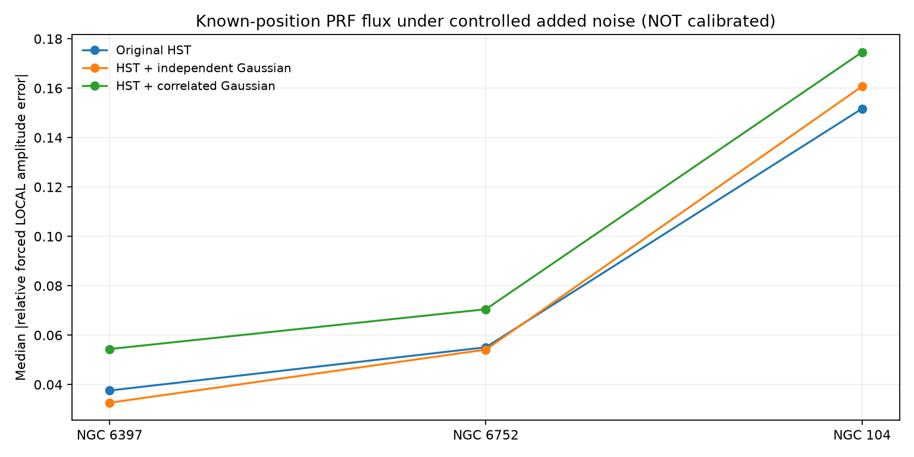

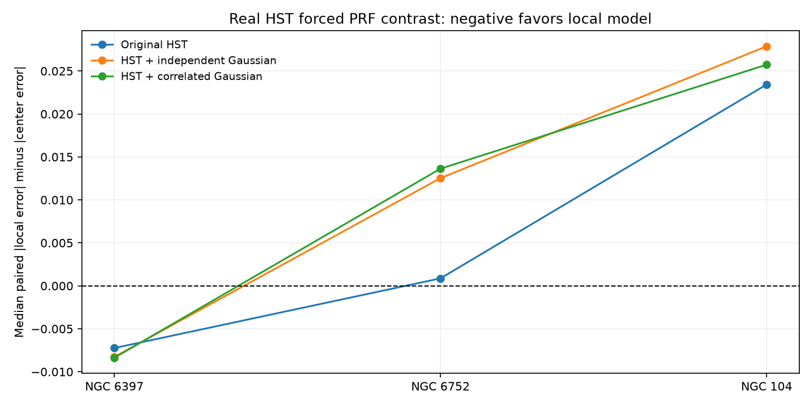

### Reproduce and audit / 溯源与复现

The experiment archive [docs/results/real_noise_v15/](docs/results/real_noise_v15/) contains **all 756 per-mode records** in [per_trial.csv](docs/results/real_noise_v15/per_trial.csv), [nine field × noise-mode summaries](docs/results/real_noise_v15/groups.csv), [72 tile-mode noise audits](docs/results/real_noise_v15/noise_audits.csv), original HST-linked [source JSON reports](docs/results/real_noise_v15/source_reports/) and [summary.json](docs/results/real_noise_v15/summary.json) with FITS/v0.14 baseline SHA-256 and GitHub Actions run provenance. Every failed/noisy-preexisting injection is included.

To reproduce all three figures directly from committed measured outputs:

```bash
python -m pip install -r requirements-smoke.txt
python -m stellarweave.noise_results \
  docs/results/real_noise_v15/source_reports/*.json \
  --out outputs/reproduced_noise_v15
```

To repeat the *full observational stress experiment*, run the [real-HST three-cluster Actions pipeline](https://github.com/ZJY-HSBL/StellarWeave/actions/workflows/cross-region.yml), which downloads HST FITS from the STScI survey, rebuilds independently train-fitted local/center PRFs and v0.14 injection sites, applies both noise modes, and publishes these images and unfiltered results. The experiment checks exactly matched source locations, held-out template IDs, original flux units, each tile's noise strength and correlation, and all baseline results.

**Physical-noise limitation:** [STScI documents correlated pixel noise after Drizzle](https://hst-docs.stsci.edu/drizzpac/chapter-3-description-of-the-drizzle-algorithm/3-3-weight-maps-and-correlated-noise), but the Gaussian smoothing in this study is only a predeclared stress scenario. The FITS `BUNIT`, exposure and gain header strings are audited; physical electron counts and the mosaic's effective noise weights have **not** been validated. Consequently **source Poisson shot noise is deliberately NOT applied to the real mosaics**. A separate unit-tested Poisson-electron primitive exists for future *verified electron-count* inputs only. Correlated-noise coefficients do not constitute a measured HST error covariance. Neither catalog completeness nor science-grade photometry is claimed.
## v0.14.0 — Real HST planted stars and forced-flux recovery / 真实哈勃人工星注入实验

**Actual STScI HST/ACS F606W science images were used as observational backgrounds.** Stars are planted one at a time using **held-out, observed, normalized HST star cutouts** which did not train either scored PRF. For each injected star, the unchanged SciPy source detector is rerun blindly; local and frozen-center PRF amplitudes are fitted separately at the **known planted coordinate**. All recovered AND missed sources are kept. This does **not** establish real stellar-population completeness, calibrated instrumental magnitude or blind photometry.

### Real HST recovery results / 三星团真实背景实验

| Cluster | Attempted planted-star trials | Blind peak recovered | Planted recovery fraction |
|---|---:|---:|---:|
| NGC 6397 | 96 | 84 | **87.50%** |
| NGC 6752 | 96 | 91 | **94.79%** |
| NGC 104 (47 Tuc) | 60 | 54 | **90.00%** |
| **Total** | **252** | **229** | **90.87%** |

Preset injection levels were **80×, 200× and 500× each tile's robust pixel RMS**, with two environmental strata: **near a pre-existing 5-sigma detection peak** (nearest peak distance 5–11 pixels), and **relatively isolated** (nearest detected peak at least 16 pixels). These are **not astronomical source SNR bins or calibrated stellar fluxes**. The one-at-a-time injected-source recovery criterion is a new detected peak within 2.5 native pixels that did not already exist in the original image.

**Sampling limitation:** NGC 104 supplies only **four relatively isolated positions per flux level** under the frozen grid/threshold rule, versus 16 per level in NGC 6397 and NGC 6752. Its total number of attempts is thus 60, not 96; the script **does not relax the separation requirement after looking at outcomes or silently discard undersampled cells**. Fractions in small-N groups have broad Wilson intervals.

| Real HST cluster | 80× RMS near peaks | 80× RMS isolated | 500× RMS near peaks | 500× RMS isolated |
|---|---:|---:|---:|---:|
| NGC 6397 | 11/16 (68.8%) | 15/16 (93.8%) | 15/16 (93.8%) | 15/16 (93.8%) |
| NGC 6752 | 13/16 (81.3%) | 16/16 (100%) | 15/16 (93.8%) | 16/16 (100%) |
| NGC 104 | 13/16 (81.3%) | 4/4 (100%, n=4) | 15/16 (93.8%) | 4/4 (100%, n=4) |

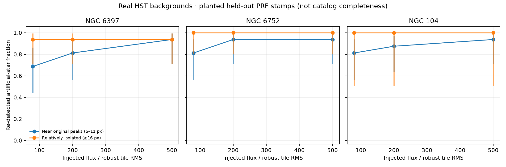

### Forced PRF flux diagnostic / 已知位置的 PSF 通量估计

Each fit uses the **true injection position** and annular-background-subtracted, unweighted native-pixel PRF amplitude. Below is the median absolute relative error in the known planted image-unit flux. The injected stars are not subjected to an added Poisson shot-noise realization, and no independent physical flux/zeropoint calibration is available. **Do not cite these numbers as calibrated HST photometric accuracy.**

| Cluster and injection condition | Local PRF median absolute error | Frozen center PRF median absolute error |
|---|---:|---:|
| NGC 6397, near peak, 80× RMS | 10.40% | 10.49% |
| NGC 6752, near peak, 80× RMS | 7.61% | 16.17% |
| **NGC 104, near peak, 80× RMS** | **35.56%** | **30.74%** |
| NGC 104, near peak, 500× RMS | 8.55% | 12.51% |

These are selected conditions for readability; **all 18 predeclared cluster × crowding × injection-flux cells**, including losses and model reversals, are in [groups.csv](docs/results/real_injections_v14/groups.csv). The full [252-trial CSV](docs/results/real_injections_v14/per_trial.csv) includes every attempted planted source, detection outcome, detected-peak position error, source-shape index, forced-local amplitude, forced-center amplitude and known injected flux.

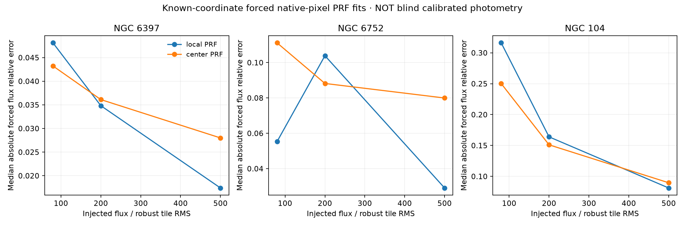

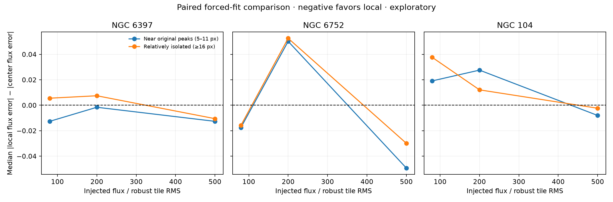

### Reproduce / 复现实验

To regenerate **all three README figures** from already committed genuine measured JSON (without re-downloading FITS):

```bash
python -m pip install -r requirements-smoke.txt
python -m stellarweave.injection_results \
  docs/results/real_injections_v14/source_reports/*.json \
  --out outputs/reproduced_injections_v14
```

The [real-HST benchmark workflow](https://github.com/ZJY-HSBL/StellarWeave/actions/workflows/cross-region.yml) independently downloads three original ACSGGCT image/catalog pairs, rebuilds the fixed-geometry PRFs, executes blind detection on each injected image and publishes reports. The [provenance summary](docs/results/real_injections_v14/summary.json) includes each FITS hash, prior PRF source hash, original GitHub Actions run ID, every loss, and explicit scientific limitations. No experimental results were fabricated or hand-drawn.

**Important methodological distinction:** blind artificial-source detection is evaluated with a known-position matching criterion; the PSF amplitude estimators are **forced at the known location**, not blind centroid/flux inference. Native detector returns integer-peak coordinates and is not a subpixel astrometric estimator. The injected PRF is an observed held-out bright star stamp; the original image noise is real, but new source photon shot noise and detector covariance are not simulated. These remain preliminary **injection recovery diagnostics**, not complete instrument-calibrated artificial-star completeness studies.
## v0.13.0 — Why does NGC 104's local PSF fail? / 真实拥挤场的分层诊断

**Actual archival HST/ACS F606W observations; same 838 previously frozen test stars across 24 outer tiles and three globular clusters.** This update does not retrain the PSF/PRF models, replace test stars, or optimize against the held-out results. Instead, it reopens the original FITS pixels to measure four image-derived **descriptive proxies** for the same v0.12 test sources: peak contrast relative to robust tile pixel RMS, nearest other detected 6-sigma peak, number of other detected peaks within 25 pixels, and 5–10-pixel annular image texture. The threshold for each high/low group is the median of the frozen **test** sources within that cluster, determined **post hoc**; these are exploratory associations, not confirmatory hypothesis tests.

### Actual three-cluster image-environment measurements

| Cluster | Median peak / tile RMS (not calibrated SNR) | Median nearest detected peak | Median detected neighbors within 25 px |
|---|---:|---:|---:|
| NGC 6397 | 879.0 | 13.93 px | 3 |
| NGC 6752 | 778.0 | 10.82 px | 7 |
| **NGC 104 (47 Tuc)** | **218.0** | **9.06 px** | **16** |

These are computed from **selected bright, approximately isolated candidates** only. Peak/tile-RMS values are **not physical stellar SNR**, and detected-peak counts exclude unresolved/faint neighbors. They should not be treated as calibrated crowding measurements or directly comparable astrophysical source fluxes.

### NGC 104 — the original weak result, separated by environment

**Metric:** per-star median paired improvement in native-pixel PRF **shape L1 error** compared with the frozen center model; positive is better, negative means the local PRF was worse. The table uses **star-pooled medians** within each exploratory subgroup, not the v0.12 median of eight tile medians.

| Post-hoc proxy | Low group (n; median gain) | High group (n; median gain) |
|---|---:|---:|
| Peak contrast / tile RMS; split at 217.98 | 128; **−1.02%** | 127; **+2.99%** |
| Detected neighbors within 25 px; split at 16 | 160; **+1.30%** | 95; **−0.93%** |
| Nearest detected peak distance; split at 9.06 px | 131; **−0.12%** | 124; **+0.60%** |

NGC 104 has **more detected neighbors and lower peak contrast** than the other two studied fields. Within NGC 104, the lower-contrast group and the higher-neighbor-count group show negative median local-model gains. These findings are **consistent with** source contamination or unstable local PRF estimation contributing to the weak aggregate result; **they do not establish causality**, and field/instrument differences remain confounders. As another contrast, NGC 6752's low- and high-nearest-neighbor-distance groups have median star gains of **+3.17%** and **+34.49%** respectively; these are also exploratory subgroup summaries.

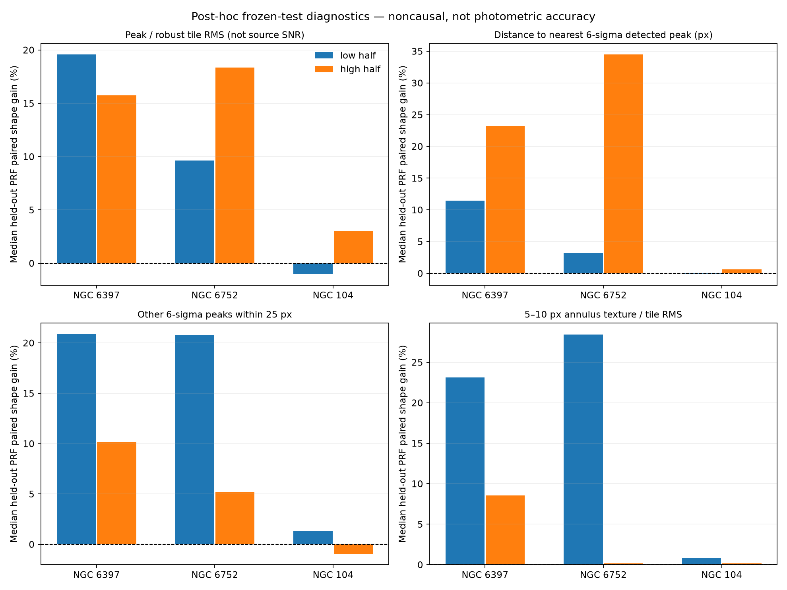

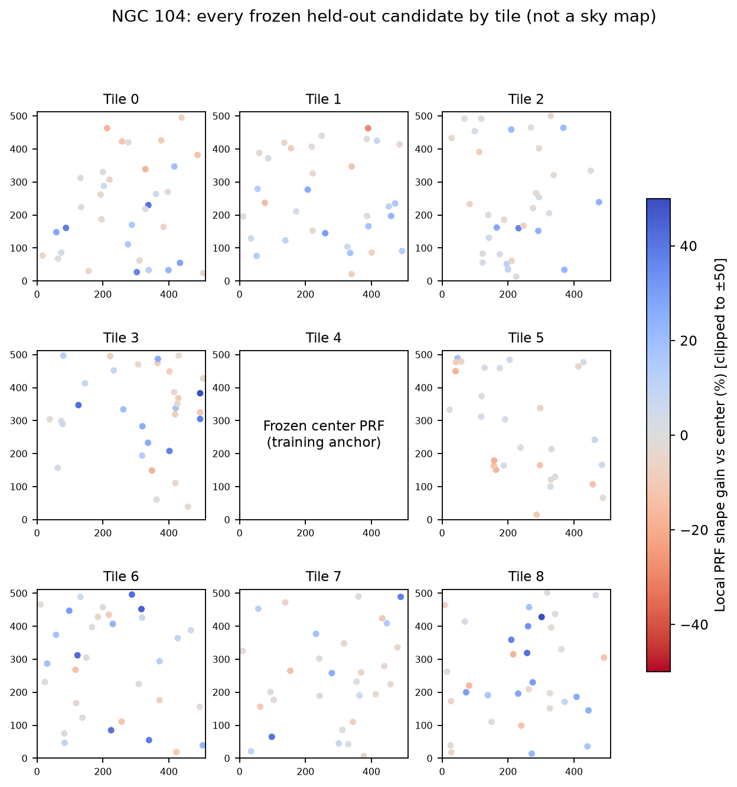

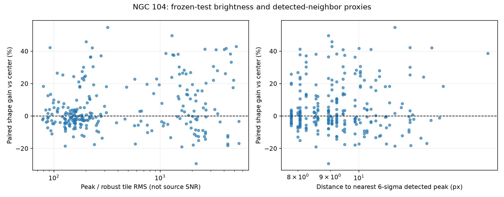

### Audit trail, source data and exact reproduction / 可追溯原始数据

The full [v0.13 diagnostic snapshot](docs/results/real_prf_v13/) includes **all 838 frozen held-out stars** in [per_star.csv](docs/results/real_prf_v13/per_star.csv), all 24 cluster × proxy × group summaries in [groups.csv](docs/results/real_prf_v13/groups.csv), [all 12 post-hoc thresholds and missingness counts](docs/results/real_prf_v13/thresholds.csv), three unfiltered [source diagnostic reports](docs/results/real_prf_v13/source_reports/), the **exact frozen v0.12 PRF baseline JSON files used for this run** in [original_prf_reports](docs/results/real_prf_v13/original_prf_reports/), and [input checksums, experiment run and limitations](docs/results/real_prf_v13/summary.json). Exact baseline snapshots matter because even harmless last-digit floating-point changes can change JSON SHA-256 between separate HST runs.

Regenerate the three figures from the archived real measurements, without downloading the large FITS mosaics:

```bash
python -m pip install -r requirements-smoke.txt
python -m stellarweave.prf_stratification_summary \
  --strat-reports docs/results/real_prf_v13/source_reports/*.json \
  --prf-reports docs/results/real_prf_v13/original_prf_reports/*.json \
  --out outputs/reproduced_v13
```

For a full new FITS run, the [real-HST workflow](https://github.com/ZJY-HSBL/StellarWeave/actions/workflows/cross-region.yml) reruns v0.12 on the same geometry, then derives v0.13 proxies from **the same FITS** and checks every original test source and score before publishing.

**Limits:** No causal explanation, independent Gaia validation, measured photometric flux bias, oversampled instrument ePSF, or completeness improvement is claimed. Twenty stars lack the annular-texture proxy near tile edges; they are **not removed from the original 838-star dataset**, and missingness is reported per group.
## v0.12.0 — Real HST spatial PSF / PRF experiments · 真实哈勃空间 PSF 实验

**Three actual HST/ACS F606W mosaics, 27 predefined disjoint tiles, 24 held-out evaluation regions, 838 evaluated held-out stars.** The same 3×3 grid is used as the astrometric benchmark. The local empirical PRF is estimated only from training stars in each tile; a frozen center-tile PRF and a fixed 2.6-pixel-FWHM Gaussian are scored on **exactly the same held-out star stamps**. No held-out star contributes to a model that is scored on that star.

### Experiment A — held-out native-pixel PRF shape accuracy / 独立恒星形状误差

The score is the L1 distance between **unit-sum normalized 15×15-pixel stellar stamps** and the model template; **lower is better**. Positive paired gain indicates that the local PRF is better than the center PRF. The interval is an exploratory 95% bootstrap over **eight spatial tiles** (not a calibrated uncertainty on flux measurements).

| Real HST cluster | Evaluated test stars in 8 outer tiles | Tiles favoring local PRF | Median tile paired gain vs center | Exploratory tile-bootstrap 95% interval |
|---|---:|---:|---:|---:|
| NGC 6397 | 300 | 8/8 | **+18.59%** | +5.66% to +26.52% |
| NGC 6752 | 283 | 8/8 | **+16.83%** | +4.59% to +25.66% |
| NGC 104 (47 Tuc) | 255 | 4/8 | **+0.35%** | −0.51% to +2.25% |
| **Total** | **838** | **20/24** | — | — |

**Important negative/ambiguous result:** NGC 104 does **not** show a consistent local-PRF advantage. Its pooled per-star median L1 is **0.4000 for local vs 0.3861 for frozen center** (local worse), even though the median of tile-level paired gains is +0.35%. These are different aggregation statistics and both are retained. Do not claim a universal performance improvement.

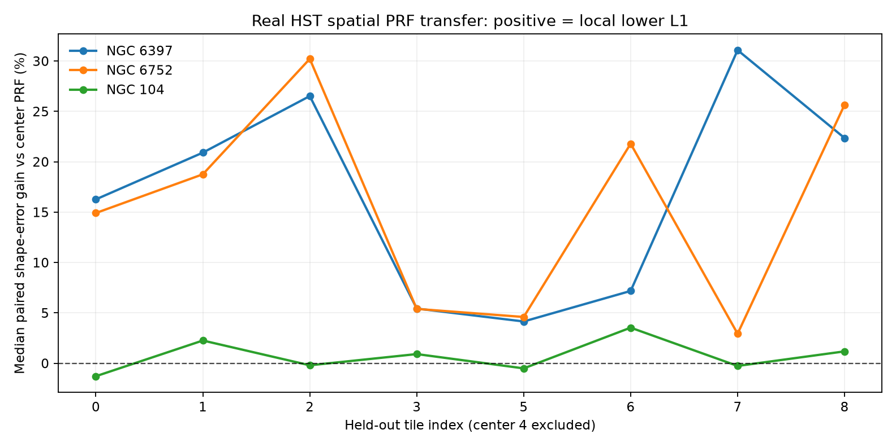

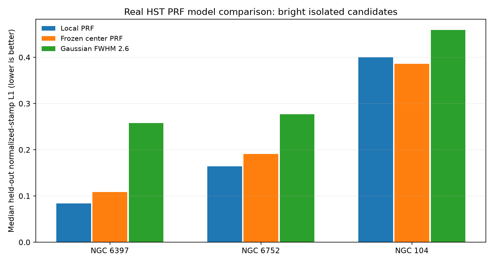

### Experiment B — PSF spatial shape diagnostics / 空间形态差异

Using the same 27 disjoint tiles, all **27/27** yield candidate native-pixel PSF stacks. The measured encircled-energy half-light radius and center-to-tile total-variation distances are **descriptive diagnostics**, not an oversampled instrument ePSF or a calibrated photometric result.

| Cluster | Usable PSF tiles | Approx. median native-pixel r50 | Median outer-tile total variation from center |
|---|---:|---:|---:|
| NGC 6397 | 9/9 | 1.414 px | 0.0252 |
| NGC 6752 | 9/9 | 1.337 px | 0.0310 |
| NGC 104 | 9/9 | 1.414 px | 0.1330 |

Half-light radii are based on discretely sampled native pixels; the values should not be interpreted as subpixel-accurate optical calibration. The large NGC 104 shape mismatch alongside its weak local-model holdout performance suggests that blending, candidate selection, or model stability require further investigation; it does **not** by itself establish the physical cause.

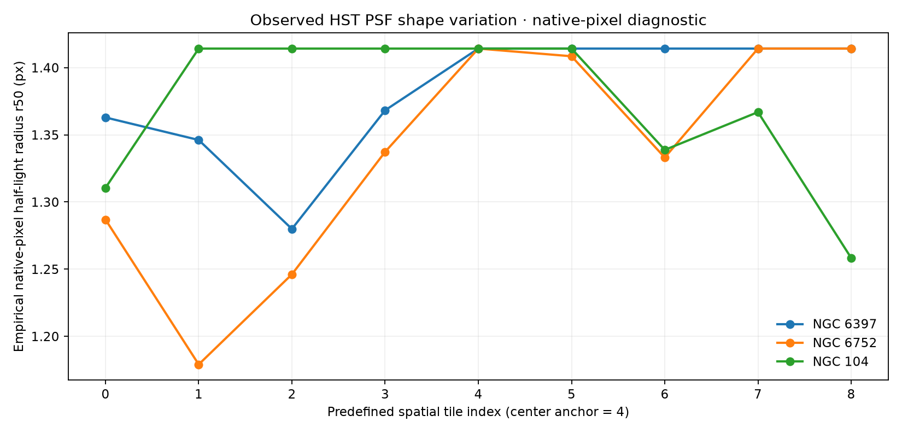

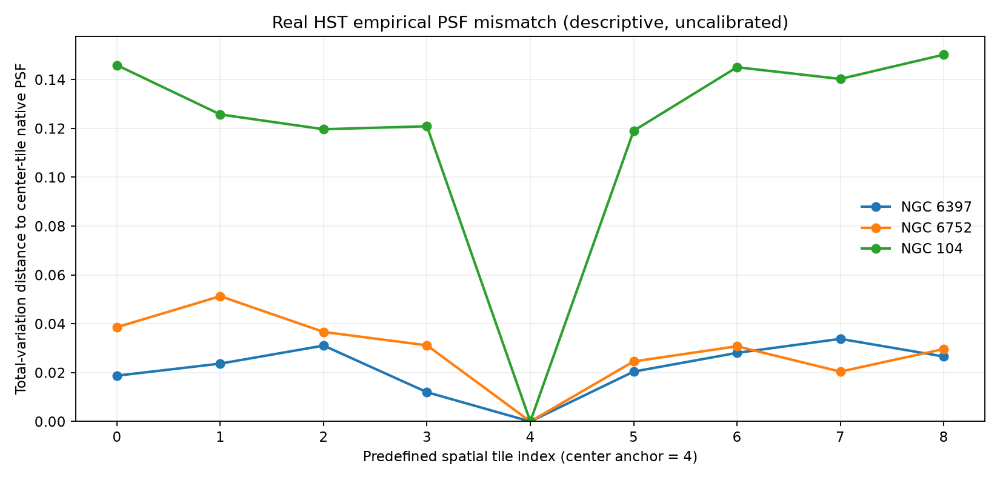

**Actual PSF template montages (not synthetic illustrations):**

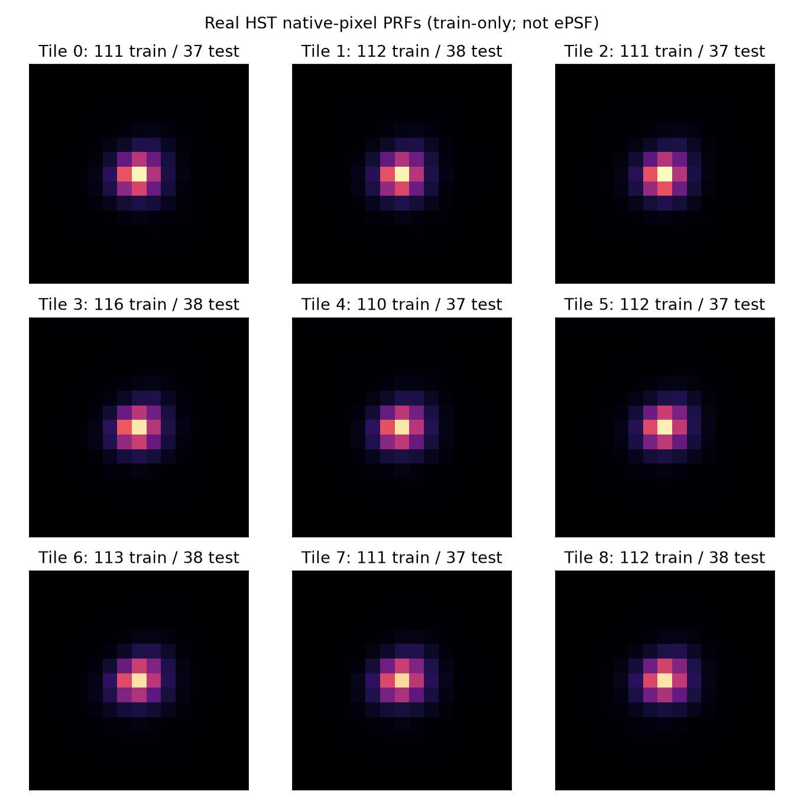

Additional montages: [NGC 6752](docs/results/real_prf_v12/ngc6752_prf_templates.png) · [NGC 104](docs/results/real_prf_v12/ngc0104_prf_templates.png) · [NGC 104 spatial PSF audit](docs/results/real_hst_v12/ngc0104_psf_montage.png).

### Full experiment evidence and reproduction / 原始数据与图表复现

The committed evidence includes the original three FITS/checksum-linked PRF JSON reports, all **838 held-out star scores** in [per_star.csv](docs/results/real_prf_v12/per_star.csv), [27 tile rows](docs/results/real_prf_v12/per_tile.csv), each cluster's selected-star CSV, PSF template montages, [summary and input hashes](docs/results/real_prf_v12/summary.json), and the separate [spatial shape diagnostics](docs/results/real_hst_v12/summary.json). FITS images are downloaded from the official STScI archive at runtime, not bundled in Git.

Regenerate the two comparative plots **without downloading FITS** from the archived measured JSON/CSV/PNG evidence:

```bash
python -m pip install -r requirements-smoke.txt
python -m stellarweave.prf_visualization \
  docs/results/real_prf_v12/source_reports/*.json \
  --out outputs/reproduced_prf_figures
python -m stellarweave.psf_results \
  --psf-reports docs/results/real_hst_v12/source_psf_reports/*.json \
  --plate-reports docs/results/real_hst_v09/source_reports/*.json \
  --out outputs/reproduced_psf_figures
```

To rerun the **full telescope experiment**, download each supported ACSGGCT F606W FITS/catalog pair and run `stellarweave.survey_cli` first, followed by `stellarweave.psf_spatial` and `stellarweave.spatial_prf` on the same frozen tile geometry. The [cross-region GitHub Actions workflow](https://github.com/ZJY-HSBL/StellarWeave/actions/workflows/cross-region.yml) executes the complete three-cluster pipeline, checks the full provenance and republishes the measured figures.

**Scientific limits / 科学边界:** Native-pixel candidate-based PRF is not an oversampled instrument ePSF; the experiment has not validated HST saturation/CTE effects, spatially correlated noise, faint-star completeness, photometric zeropoints, or external Gaia absolute astrometry. The observed L1 reductions are **shape-reconstruction improvements only**, not demonstrated flux-error or astrometric-precision improvements.
## Real HST experimental results / 真实哈勃实验数据与可复现图表

**Observed data, not a simulated performance claim.** The following numbers come from actual STScI ACSGGCT F606W FITS mosaics and matching public survey catalogs, processed by [Cross-region / Cross-cluster Astrometry](https://github.com/ZJY-HSBL/StellarWeave/actions/workflows/cross-region.yml). Each cluster is fitted on its central 512×512-pixel tile and evaluated using the **same frozen transform** on eight disjoint 512×512 held-out tiles. A separate plate solution is trained for each cluster.

| Real HST target | Survey catalog rows | Quality-selected catalog | Matches / evaluated bright references | Pooled selected-reference match rate | Median of 8 tile median residuals |
|---|---:|---:|---:|---:|---:|
| NGC 6397 | 16,100 | 12,947 | 2,239 / 2,266 | **98.81%** | **0.399 px** |
| NGC 6752 | 52,817 | 38,804 | 2,374 / 2,400 | **98.92%** | **0.407 px** |
| NGC 104 | 158,154 | 106,281 | 2,366 / 2,400 | **98.58%** | **0.405 px** |
| **Total** | **227,071** | **158,032** | **6,979 / 7,066** | **98.77%** | — |

**Internal held-out QC: 24/24 regions passed.** These fractions are **NOT all-star detection recall**, and the residuals are **NOT independently validated absolute astrometry**. The selected bright-reference subset, the HST image and its survey catalog are related products. Gaia-to-HST external precision, science-grade flux accuracy and faint-star completeness remain unmeasured.

### Actual measured plots / 真实实验曲线

**Figure 1.** Per-tile median matching residual after transferring the center-tile affine solution without refitting. The vertical axis is deliberately zoomed to reveal differences within the measured 0.38–0.43 pixel range.

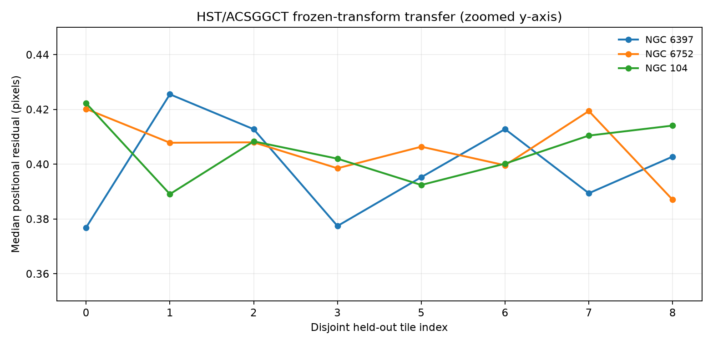

**Figure 2.** One-to-one matched fraction for the eight nonoverlapping evaluation tiles in each real cluster. The vertical axis is deliberately zoomed; these percentages refer only to preselected bright survey reference candidates.

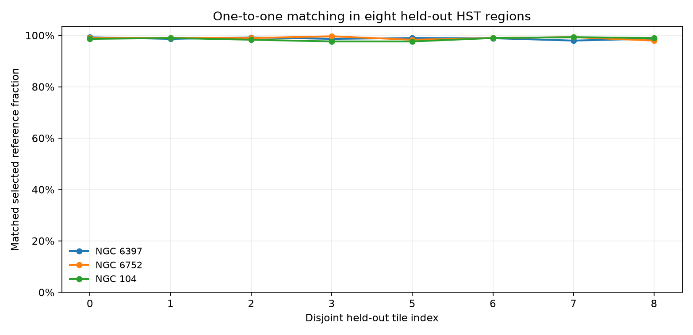

**Figure 3.** Counts of original catalog records and quality-selected catalog stars in the three real observed fields. These are archive catalog counts, not model detections.

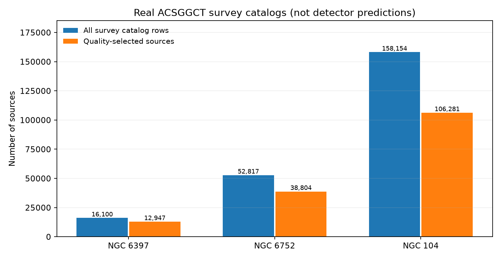

### Reproduce every figure / 图表复现

The original **three unfiltered per-tile JSON reports**, the 24-row [per-tile CSV](docs/results/real_hst_v09/per_tile.csv), and the machine-readable [summary with source SHA-256 and GitHub Actions run ID](docs/results/real_hst_v09/summary.json) are committed under [docs/results/real_hst_v09/](docs/results/real_hst_v09/). The images are rendered from those reports, not redrawn by hand.

```bash
python -m pip install -r requirements-smoke.txt
python -m stellarweave.result_visualization \
  docs/results/real_hst_v09/source_reports/*.json \
  --out outputs/reproduced_hst_figures
```

The three-cluster GitHub Actions matrix downloads official FITS/catalog files, runs all spatial evaluations, creates the JSON/CSV and PNG figures, and publishes the evidence snapshot. Every region, including any future rejected tile, is retained; missing or duplicated cluster reports fail the visualization build.

**Experiment reporting rule / 实验报告原则：** future versions should put genuine measured metrics and figures in README, retain their source data and provenance, clearly distinguish simulations from telescope observations, and explicitly state negative results. No claimed algorithmic improvement without a reproducible controlled comparison.
## v0.11.0 — Real-data evidence and FITS epoch provenance / 真实实验与观测历元审计

**Reproducible results, not just screenshots.** The three real ACSGGCT clusters now have committed per-tile CSV/JSON, verified source hashes, three auto-generated README figures, and an automatic GitHub Actions evidence-publication step. All figures come directly from actual telescope data processing and are regenerated on future benchmark runs; the synthetic test suite is separately identified.

### HST FITS header timing audit / 图像观测时间元数据

| Observed field | FITS header date hint (MJD) | Corresponding calendar date | Effective mosaic epoch verified? |
|---|---:|---|---|
| NGC 6397 | 53884 | 2006-05-29 | **No** |
| NGC 6752 | 53879 | 2006-05-24 | **No** |
| NGC 104 | 53807 | 2006-03-13 | **No** |

The dates above are **only explicit day-level FITS header hints**, extracted from real archived mosaics by `stellarweave.epoch_audit`. They are not established weighted mean observation epochs. A stacked image may contain multiple exposures taken at different times; no Gaia external accuracy is claimed on the basis of these dates.

Run the conservative audit on an already downloaded FITS file:

```bash
python -m stellarweave.epoch_audit \
  --fits data/raw/ngc6397/hlsp_acsggct_hst_acs-wfc_ngc6397_f606w_v2_img.fits \
  --out outputs/ngc6397_epoch_audit.json
```

Raw audit records are retained in [docs/results/real_hst_v09/epoch_audits/](docs/results/real_hst_v09/epoch_audits/). The tool deliberately marks `effective_mosaic_epoch_verified=false`; independent exposure-provenance research remains necessary before running a publishable Gaia DR3 comparison.
## v0.10.0 — Gaia DR3 epoch-aware external astrometry / 外部天体测量验证接口

**Implementation available; actual Gaia/HST independent astrometry has NOT been measured yet.** The standard CI currently verifies this code using generated FITS and Gaia-shaped reference data. A genuine external comparison additionally needs authentic ESA Gaia DR3 records and a defensible HST reference epoch for the mosaic. A manually chosen, unverified epoch cannot support a published precision claim.

### 1. Fetch actual Gaia DR3 source data (optional network dependency)

Install optional dependency `python -m pip install 'astroquery>=0.4.9,<0.5'` (not required for ordinary synthetic CI). For a real official F606W FITS downloaded previously:

```bash
python -m stellarweave.gaia_fetch \
  --fits data/raw/ngc6397/hlsp_acsggct_hst_acs-wfc_ngc6397_f606w_v2_img.fits \
  --max-rows 3000 --gmag-max 19.5 \
  --out outputs/gaia/ngc6397_gaia_dr3.csv
```

This obtains source ID, RA, Dec, two proper-motion components, the Gaia reference epoch, G magnitude, RUWE and visibility periods from the **official `gaiadr3.gaia_source` table**. A bright-star/quality filter is used, the request is size-bounded, and the code **fails on truncated TOP results** instead of claiming completeness. The adjacent `_provenance.json` stores the actual ADQL query, sky cone, SHA-256 files and source counts.

### 2. Build a frozen HST solution, independently of Gaia

```bash
python -m stellarweave.survey_cli \
  --fits data/raw/ngc6397/hlsp_acsggct_hst_acs-wfc_ngc6397_f606w_v2_img.fits \
  --catalog data/raw/ngc6397/hlsp_acsggct_hst_acs-wfc_ngc6397_r.rdviq.cal.adj.zpt \
  --cluster ngc6397 --grid 3 --tile-size 512 \
  --out outputs/ngc6397_plate
```

The frozen affine solution comes **only from the ACSGGCT HST survey catalog**, not Gaia. The `cross_region.json` output records accepted held-out regions.

### 3. Compare the existing solution against Gaia on a withheld region

Read the actual HST observation epoch (or determine a scientifically defensible effective mosaic epoch from its constituent exposures). No default date is supplied. Substitute `VERIFIED_HST_MJD` with a real Modified Julian Date:

```bash
python -m stellarweave.gaia_eval_cli \
  --fits data/raw/ngc6397/hlsp_acsggct_hst_acs-wfc_ngc6397_f606w_v2_img.fits \
  --gaia-csv outputs/gaia/ngc6397_gaia_dr3.csv \
  --plate-report outputs/ngc6397_plate/cross_region.json \
  --hst-mjd VERIFIED_HST_MJD --eval-tile 0 \
  --out outputs/gaia/ngc6397_external_check.json
```

Only a **pre-existing, QC-passing, non-anchor tile** can be tested. The affine parameters are never adjusted using Gaia stars. Astropy propagates DR3 sky positions from `ref_epoch` to the supplied HST MJD using proper motions (`pmra` already includes cos Dec). The report stores matched-source fractions, pixel-coordinate residuals, six displaced-catalog null controls and file SHA-256.

A `GAIA_DIAGNOSTIC_PASS` requires five matches, at least 20% eligible-star matching, a match/null ratio of at least 3, median residual ≤1.2 pixels and p95 residual ≤1.8 pixels. These are **exploratory guardrails**, not externally certified absolute astrometric uncertainties. Gaia angular propagation currently omits parallax and radial velocity where the input subset does not provide them; perspective effects, crowded-field selection, mosaic epoch/optical distortion and correlated systematics require further modeling.

The manually triggered [Gaia DR3 External Check workflow](https://github.com/ZJY-HSBL/StellarWeave/actions/workflows/gaia-external.yml) performs the entire external-query experiment only when an operator provides a verified HST MJD and withheld tile index. The live ESA TAP query is **not** part of the automated release quality gate. No actual Gaia-to-HST success ratio is claimed for this release.

Reference: [ESA Gaia DR3 ADQL examples](https://www.cosmos.esa.int/web/gaia-users/archive/writing-queries), [Astropy space motion](https://docs.astropy.org/en/stable/coordinates/apply_space_motion.html).
## v0.9.0 — Three-cluster, eight-region frozen-transfer validation / 三星团跨区域验证

**Actual telescope images and public photometric catalogs. No manual star labeling.**

The earlier v0.8 512px central-tile plate solution looked internally consistent, but it had not been tested outside the original crop. v0.9 now uses three independent ACSGGCT targets: **NGC 6397, NGC 6752 and NGC 104**. Each target receives its **own** plate solution fitted to one prespecified center tile; this transform is then FROZEN and evaluated on eight disjoint, non-overlapping test tiles from the same target. No target shares an affine transform with another cluster.

### Verified GitHub matrix results (2026-10-17)

| Cluster | Public photometric catalog rows | Center-fit QC | Disjoint transfer tiles |
|---|---:|---|---:|
| NGC 6397 | 16,100 | PASS | 8/8 |
| NGC 6752 | 52,817 | PASS | 8/8 |
| NGC 104 | 158,154 | PASS | 8/8 |
| **Overall** | **227,071** | **3/3** | **24/24** |

The first mosaic-wide nine-grid layout produced only 0–2 passing tiles per cluster because some mosaic corners had **no reference stars**. The protocol was corrected *before the reported final run*: tiles are positioned around the **median projected sky position of existing survey references**, not chosen after inspecting detection success. This is a pre-measurement geometrical sampling rule, and all final 512×512 tiles remain disjoint. The fixed spatial sampling rule is shared across all clusters.

These successes mean each nonoverlapping region passes predefined **internal matched-source and null-control QC**, NOT that all stars are recovered, not that absolute sky coordinates are externally calibrated, and not that cross-cluster affine parameters transfer. This is **not** an astronomical completeness or flux-accuracy result. The catalogs and FITS mosaics originate from the same survey program, so their errors may be correlated.

Reproduce **one target** using publicly downloaded archive files:

```bash
python -m stellarweave.download_acsggct --cluster ngc6752 --band f606w
python -m stellarweave.survey_cli \
  --fits data/raw/ngc6752/hlsp_acsggct_hst_acs-wfc_ngc6752_f606w_v2_img.fits \
  --catalog data/raw/ngc6752/hlsp_acsggct_hst_acs-wfc_ngc6752_r.rdviq.cal.adj.zpt \
  --cluster ngc6752 --grid 3 --tile-size 512 --seed 42 \
  --out outputs/cross_region_ngc6752
```

Results: `cross_region.json` contains each tile's coordinates, local diagnostic fit, fixed-anchor transfer result, rejection reason, source counts, match fractions and null controls; `cross_region.csv` supplies a tabular comparison. The CI [Cross-region / Cross-cluster Astrometry workflow](https://github.com/ZJY-HSBL/StellarWeave/actions/workflows/cross-region.yml) downloads all three clusters separately, enforces a conservative no-regression criterion, and generates a combined machine-readable summary as a GitHub Artifact.

**Outstanding scientific validation:** external or withheld independent reference catalogs, plate distortion across entire HST mosaics, local ePSF and correlated noise estimation, calibrated magnitude completeness, and a full DOLPHOT/Photutils science-baseline comparison.
## v0.8.0 — Wide-shift plate registration with held-out QC / 大偏移星场配准

**Major real-observation result:** the prior 3-pixel near-WCS matcher rejected NGC 6397 because the correct observed offset was approximately **(+11, −1) pixels**. The new workflow searches multiple initial translations up to ±192 px using displacement voting, optimizes a near-identity affine transformation, and checks matched stars on a disjoint held-out subset. It also uses displaced-catalog null controls to diagnose chance matches in dense star fields.

Reproduce the analysis on officially downloaded NGC 6397 F606W data:

```bash
python -m stellarweave.spatial_cli \
  --fits data/raw/ngc6397/hlsp_acsggct_hst_acs-wfc_ngc6397_f606w_v2_img.fits \
  --catalog data/raw/ngc6397/hlsp_acsggct_hst_acs-wfc_ngc6397_r.rdviq.cal.adj.zpt \
  --size 512 --grid-cells 2 --match-radius 3 \
  --out outputs/ngc6397_spatial_v08
```

Results for the specified public FITS image central 512×512 crop (GitHub Actions run on 2026-10-17):

| Statistic | Value |
|---|---:|
| Training reference sources | 260 |
| Training matched | **255 (98.1%)** |
| Held-out reference sources | 150 |
| Held-out matched | **147 (98.0%)** |
| Affine translation x, y | **+10.9713 px, −0.9434 px** |
| Training RMS | **0.4058 px** |
| Held-out median / 95th percentile residual | **0.3759 / 0.6023 px** |
| Shifted-null match-count median (six controls) | **2** |
| Held-out versus null-count ratio | **73.5** |
| Candidate PSF cells | **4/4** |

The legacy narrow-window matcher still reports `AFFINE_QC_REJECTED`, whereas the new wide-shift matcher reports **`HELDOUT_QC_PASS`**. This is important **internal geometric corroboration**: the fitted sources are not an independently calibrated absolute astrometric reference, and withheld catalog sources are not fully statistically independent because both reference sets share the same image detections. Null shifts are diagnostics, **not a formal p-value**. We therefore continue to mark `science_calibrated: false`.

The improved `astrometry_overlay.png` plots raw WCS stars separately from the held-out-QC-passing affine alignment in different marker colors, so that the change is visually inspectable. Machine-readable training/held-out residuals, shift hypothesis and null controls are in `spatial_diagnostics.json` under `wide_shift_heldout_plate_search`.

**Research limitation:** this is a WCS-guided small-rotation/scale plate corrector, not an unrestricted blind plate solver. It assumes roughly correct orientation/scale, a translation within the configured range, and enough stars. Scientific release requires multi-crop and independent external-catalog verification, distortion and ePSF characterization, and physically calibrated uncertainty estimates.
## v0.7.0 — Spatial PSF and Catalog-WCS Diagnostics / 空间 PSF 与星表配准诊断

**This release performs exploratory spatial diagnostics on genuine HST data. It does NOT deliver a validated astrometric solution or science-grade ePSF.**

First download the original STScI ACSGGCT NGC 6397 F606W image and joint two-filter catalog using `stellarweave.download_acsggct`, as described below. Then run:

```bash
python -m stellarweave.spatial_cli \
  --fits data/raw/ngc6397/hlsp_acsggct_hst_acs-wfc_ngc6397_f606w_v2_img.fits \
  --catalog data/raw/ngc6397/hlsp_acsggct_hst_acs-wfc_ngc6397_r.rdviq.cal.adj.zpt \
  --size 512 --grid-cells 2 --stamp-size 15 --min-stars 3 \
  --match-radius 3 --out outputs/ngc6397_spatial_v07
```

Outputs: `spatial_diagnostics.json` records reference counts, one-to-one raw WCS matches and quality-checked *candidate* affine fit; `astrometry_overlay.png` overlays catalog positions and detected peaks; `spatial_psf_grid.png` shows the local native-pixel PSF estimates, and `psf_yN_xM.npy` provides the individual diagnostic stamps.

### First real NGC 6397 findings

From the successful public-archive GitHub Actions run on October 17, 2026:

| Quantity | Diagnostic result |
|---|---:|
| Public photometric catalog | 16,100 sources |
| Reference stars projected into selected 512×512 image crop | 533 |
| Brighter reference stars selected | 350 |
| Pixel-space brightness peaks detected | 679 |
| Raw WCS-position pairs at <=3 pixels | 36 |
| Fraction of selected references matched | 10.3% |
| Candidate PSF cells with local stars | 4 / 4 |
| Affine registration proposal | **REJECTED BY QC** |

The raw matched positions have a **median separation of about 2.47 px**; with a crowded stellar field, many pairs may be accidental. The affine estimate failed the final inlier/residual criterion. This is a scientifically relevant **negative diagnostic result** and must not be reported as successful stellar-catalog registration.

**Consequences:** no trusted real-data training labels or completeness measurements are emitted by this diagnostic. The next step is to check the particular FITS WCS/reference-frame mapping, broaden and independently validate plate-solving initialization, and test matched stars against independent withheld measurements. The local native-pixel PSFs must also be checked for undersampling, crowding biases, spatial dependence and instrument calibration; they are not a full spatially adaptive oversampled HST ePSF.

Read the [real-HST workflow record](https://github.com/ZJY-HSBL/StellarWeave/actions/workflows/real-hst.yml) and download the `ngc6397-real-hst-audit` diagnostic artifact from the successful run for plots and machine-readable data.
## v0.6.0 — Genuine HST FITS & Catalog Audit / 真实天文观测数据审计

**Real official NGC 6397 was successfully downloaded and inspected in GitHub Actions.** In the tested release candidate, the official ASCII catalog contained **16,100 records**, and the selected 512×512 FITS crop had **100% valid pixels**. A robust native-pixel candidate PSF was estimated from **79 isolated bright source candidates**. These are raw data-quality figures, **not detection completeness or measurement accuracy**.

Official directory: https://archive.stsci.edu/pub/hlsp/acsggct/ngc6397/

Download the actual F606W image and paired catalog:

```bash
python -m stellarweave.download_acsggct --cluster ngc6397 --band f606w --out data/raw
```

Audit the files and create a native-pixel candidate PRF:

```bash
python -m stellarweave.real_hst_cli \
  --fits data/raw/ngc6397/hlsp_acsggct_hst_acs-wfc_ngc6397_f606w_v2_img.fits \
  --catalog data/raw/ngc6397/hlsp_acsggct_hst_acs-wfc_ngc6397_r.rdviq.cal.adj.zpt \
  --size 512 --stamp-size 15 --fwhm 2.6 \
  --out outputs/ngc6397_real_audit
```

Outputs: `audit.json` for FITS unit/exposure/filter/ERR/DQ/WCS presence, catalog row counts, and SHA-256; `selected_psf_stars.csv` for isolated candidate positions; `empirical_prf_native.npy` (unit-normalized local PSF stamp), and `psf_preview.png`.

The audit records FITS scientific pixels, not scientifically verified WCS star matches. The PSF is only a single-tile, native-pixel empirical estimate: **not an oversampled HST instrumental ePSF**, not photometrically calibrated, and not guaranteed transferable to another location. Real HST detection completeness, per-star flux accuracy, noise covariance and physical uncertainty propagation are **not measured**.

[View the Real HST Archive Audit workflow](https://github.com/ZJY-HSBL/StellarWeave/actions/workflows/real-hst.yml). GitHub artifacts contain only small QA products, not redistributed original FITS/catalog files.
## v0.5.0 — PSF photometry benchmark / 精密测光基线

This research baseline compares **DAOStarFinder centroids**, **PSFPhotometry**, and **IterativePSFPhotometry**, as implemented in Photutils 3.x, using the **same injected images, source positions, and input flux levels** in every trial. An optional SciPy centroid control is also available.

Install dependencies, then run a small reproducible synthetic benchmark:

```bash
python -m pip install -r requirements.txt
python -m stellarweave.benchmark_cli \
  --size 160 --trials 2 --per-flux 4 \
  --flux-levels 700 2000 5000 \
  --methods dao psf iterative --seed 42 \
  --out outputs/photometry_v05

```

Outputs: `source_results.csv` contains per-star detection/recovery, localization error, and fitted flux (where available); `benchmark.json` stores matched-sample recovery and Wilson intervals for all methods; `method_comparison.png` plots completeness-vs-instrumental-flux on identical injections.

**Fair comparison protocol:** we create one set of non-overlapping artificial stars per trial, inject each set into the same untouched image, and run each method on precisely those pixels. Baseline source detections are removed before scoring newly detected sources. For recovered isolated injected stars, fitted flux is compared with known instrumental injected flux. Near an original star, flux attribution is ambiguous and is **not used** in the flux-error summary.

**Science limitations:** all measurements here are *toy* or *exploratory*. A single analytic or image PRF can suffer PSF mismatch; reduced chi-square and reported formal flux errors cannot be interpreted as calibrated uncertainty without a physically justified per-pixel error array. Matched-source recovery does not by itself establish deblending completeness. Real-FITS flux and PSF are instrument/filter-specific, and this release does not model injected photon noise, drizzle correlations, detector gain/read noise, or spatial PSF variability. No quantitative HST results are claimed.

Example *only* for a real image (do not run until PSF and FITS units are verified):

```bash
python -m stellarweave.benchmark_cli \
  --fits data/raw/ngc6397/YOUR_VALID_F606W_IMAGE.fits \
  --psf-stamp data/psf/YOUR_VERIFIED_SAME_BAND_PRF.npy \
  --image-unit ELECTRONS/S --size 160 \
  --flux-levels 0.05 0.2 0.8 \
  --methods dao psf iterative --out outputs/hst_psf_benchmark

```

See [Photutils PSF photometry docs](https://photutils.readthedocs.io/en/3.1.0/user_guide/psf.html), [PSFPhotometry](https://photutils.readthedocs.io/en/3.1.0/api/photutils.psf.PSFPhotometry.html), and [IterativePSFPhotometry](https://photutils.readthedocs.io/en/3.1.0/api/photutils.psf.IterativePSFPhotometry.html).

## v0.4.0 — Artificial-star injection and recovery / 人工星注入恢复

**No manual star annotation is needed for artificial-star truth**: injection position and **instrumental** flux are saved exactly. This first implementation is a *methodological* completeness experiment, **not calibrated HST faint-star completeness**.

Quick synthetic experiment (no external telescope files required):

```bash
python -m stellarweave.injection_cli --size 320 --detector scipy \
  --flux-levels 350 800 1800 4000 --trials 3 --per-flux 8 \
  --seed 42 --out outputs/injection_v04
```

Run on a real FITS science image only after obtaining a **pixel-integrated, properly centered and matched-filter/instrument PSF** as a two-dimensional odd-sized NumPy \`.npy\` file. Its sum is normalized to one, and injected total flux must be in the original FITS image's \`BUNIT\`; the CLI rejects a mismatched supplied unit:

```bash
python -m stellarweave.injection_cli \
  --fits data/raw/ngc6397/example_science.fits \
  --psf-stamp data/psf/ngc6397_f606w_prf.npy \
  --image-unit ELECTRONS/S --size 320 --crop-x 512 --crop-y 512 \
  --fwhm 2.6 --detector scipy --trials 5 --per-flux 10 \
  --flux-levels 0.01 0.03 0.10 0.30 \
  --out outputs/ngc6397_injections
```

The above FITS filename, PSF filename and flux levels are **illustrative**; select real files and a sensible flux range based on image calibration. A PSF extracted from stars, without accurate background subtraction and verification that it represents a pixel-integrated PRF, is **not automatically valid**.

Outputs: \`injections.csv\` (per injected source; original x/y, flux, distance to original detections, crowding class, recovery flag and position error), \`manifest.json\` (settings, baseline counts, trial totals and Wilson intervals), and \`completeness.png\` (recovery curves). Each trial injects into the **same untouched base image** to avoid cumulative contamination. Injected-source spacing is controlled to avoid artificial crowding from other injected sources.

**Interpretation limitations**:

- The baseline must be run on the **unmodified** image; recovery is credited only for *new* detections, excluding previously existing centroids. This is intentionally conservative close to existing sources and is **not a PSF-deblending benchmark**.
- "Unmatched new candidates" are **not equivalent to false positives**, because the original sky star catalog is not exhaustive. The distance to the nearest original detection is only a proxy for actual crowding.
- The supplied PSF is treated as fixed across the selected image tile. The expectation-only addition doesn't propagate new photon shot noise or account for drizzled noise correlations, pixel-area correction, exposure weighting, or PSF variation.
- Recovery versus *instrumental flux* must not be reported as a calibrated completeness-versus-magnitude curve until image units and photometric zero points are validated.
- Wilson 95% intervals assume independent Bernoulli observations; repeated injections into the same background may be correlated. More robust later work will use image/tile and injection-batch bootstrapping.
- Baseline \`scipy\` and \`dao\` source detectors are available. Strong science claims require validation against DOLPHOT/Photutils iterative PSF photometry and real ACS image products.

Reference: [Photutils PSF photometry](https://photutils.readthedocs.io/en/stable/user_guide/psf.html) and [pixel-integrated PSF simulation](https://photutils.readthedocs.io/en/stable/reference/psf_api.html).


## Source data / 公开数据（不需人工逐星标注）

Use the [ACS Survey of Galactic Globular Clusters](https://archive.stsci.edu/prepds/acsggct/) from NASA/STScI's MAST archive. Its stellar photometric catalogs are **reference measurements**, not exhaustive ground truth. [Anderson et al. (2008)](https://arxiv.org/abs/0804.2025) Table 4 documents the actual 23-column RDVIQ catalog: ID, reference-frame x/y, F606W and F814W magnitudes/errors, number of exposures, unsaturated/saturated flags, neighbor contamination, PSF quality, and RA/Dec.

Default NGC 6397, then independent clusters NGC 6752 and NGC 104. Note that the actual `.rdviq.cal.adj.zpt` file header has been checked and verified as 23-column and alignment against the specific image.

## Install / 安装

Python 3.11–3.12:

```bash
python -m pip install -r requirements.txt
python -m pytest -q
```

Minimal synthetic test without astronomy dependencies:

```bash
python -m pip install -r requirements-smoke.txt
python -m stellarweave.cli --detector scipy --size 512 --stars 300 --seed 42 --out outputs/demo
```

Synthetic precision, recall and localization error must **never be reported as HST scientific performance**.

## Generate HST training tiles / 准备真实 FITS 与星表

**1. Download the public image/catalog pair (internet required):**

```bash
python -m stellarweave.download_acsggct --cluster ngc6397 --band f606w --out data/raw
```

Specific archive URLs are used instead of searching arbitrary observations. If a link changes, the downloader reports the URL and stops. Files total hundreds of MB. The MAST directory is [here](https://archive.stsci.edu/pub/hlsp/acsggct/ngc6397/).

**2. Join the documented catalog to the matching FITS via sky WCS:**

```bash
python -m stellarweave.prepare_hst \
  --fits data/raw/ngc6397/hlsp_acsggct_hst_acs-wfc_ngc6397_f606w_v2_img.fits \
  --catalog data/raw/ngc6397/hlsp_acsggct_hst_acs-wfc_ngc6397_r.rdviq.cal.adj.zpt \
  --band f606w --alignment affine --tile-size 256 --guard 64 \
  --out data/processed/ngc6397
```

**3. Inspect the output before training.** `alignment_qc.png` plots candidate label positions on the actual image, and `manifest.json` records reference-quality cuts, SHA-256 input hashes, estimated translation, crossmatch inliers/RMS, and train/validation/test tile counts.

The default alignment initializes from a global translation and fits a **six-parameter affine transformation** with one-to-one matching, residual clipping, RMS/p95/coverage QC, and a 3×3 local-residual grid. It is not a complete optical-distortion or absolute astrometric solution. If auto alignment fails, investigate the frame; do **not** silently use unverified labels.

For diagnostic-only projection:

```bash
python -m stellarweave.prepare_hst --fits PATH --catalog PATH --alignment wcs --out data/diagnostic
```

This explicitly records `UNVERIFIED_WCS_ONLY`. An operator-specified `--alignment manual --dx N --dy N` is also unverified. Neither output is benchmark ground truth.

**Export structure:**

```text
data/processed/ngc6397/
  manifest.json
  alignment_qc.png
  index.csv
  train/*.npz
  val/*.npz
  test/*.npz
```

Each `.npz` contains raw float32 `image`, a `valid` mask, and `labels` with tile-local, 0-based (x,y), calibrated Vega magnitude, its error, and source ID. These are **point labels, not bounding boxes**; no arbitrary magnitude-to-flux conversion is performed.

The default data split uses spatially separated vertical stripes and a guard region to limit data leakage. Boundary tiles are intentionally discarded, **not counted as missed detections**. To reserve an entire different cluster: add `--split test-only`, and never tune thresholds on it.

## Two-filter association / F606W + F814W 关联（v0.3）

The public ACSGGCT NGC 6397 / NGC 104 / NGC 6752 directories contain a single **F606W reference FITS image** and a two-filter photometry catalog; **no corresponding F814W FITS reference image** is present in those directories. Earlier README instructions claiming that an F814W image can be downloaded from the same directory were incorrect. The downloader now rejects such a request.

The joint catalog already has F606W and F814W magnitudes for color–magnitude analyses. The optional `stellarweave.dualband` program requires a **separately obtained, matched-field F814W FITS file with independently checked WCS**; it does not fetch or validate such a file automatically.

```bash
python -m stellarweave.download_acsggct --cluster ngc6397 --band f606w
```

Products: `paired_reference.csv` with each common source ID, RA/Dec, independently mapped F606W and F814W pixel coordinates, calibrated Vega magnitudes, color, and errors; `dualband_manifest.json` includes per-filter affine residual QC and input SHA-256 hashes. The two bands are **not resampled onto one pixel grid**, and those magnitudes originate from the published catalog; no new photometric inference is performed.

The affine fitting uses a conservative initialization based on a near-identity WCS projection. Large initial rotations, scales, and incorrect WCS may fail closed rather than producing misleading labels. For field calibration one must examine the accepted matches spatially and adjust image/catalog selection or use professional astrometric tools.

Unverified `--alignment wcs` or manual-shift positions are **diagnostic only**, and v0.3 prevents their export into regular train/validation sets unless the output split is explicitly `test-only`. This is still not scientific benchmark truth.

## Scientific limitations / 科学限制

1. A catalog built from multiple exposures is not a perfect label set for one mosaic; faint or blended stars can be missing in either.
2. The actual `.adj.zpt` archive contains 23 columns. v0.6 correctly maps wV/wI, xsig/ysig, othV/othI and qfitV/qfitI before RA/Dec. These are survey diagnostics; their interpretation needs domain validation.
3. Verified affine correspondence is not complete astronomical astrometry; a QC plot and the 3×3 residual grid still require human inspection.
4. ACS `BUNIT`, exposure, zeropoints, DQ masks, correlated noise and PSF vary. This release does not do calibrated PSF flux fitting.
5. The separate GitHub workflow has downloaded and audited the real NGC 6397 FITS and catalog. This does not yet establish their star-by-star astrometric registration or scientifically calibrated PSF photometry.

## Roadmap / 开发路线

- **v0.3**: affine/local astrometric residual maps and reference-catalog two-band association implemented on constructed data; **real archive verification remains outstanding**.
- **v0.4**: synthetic and guarded FITS injection/recovery protocol implemented; real scientific calibration and noise modeling remain outstanding.
- **v0.5**: common-injection PSF and iterative-PSF baselines implemented; science-grade uncertainty validation remains future work.
- **v0.6**: real archive ingest, fixed 23-column catalog, DQ/ERR/BUNIT/WCS metadata audit, native-pixel PSF diagnostic; instrument-calibrated physical models remain future work.
- **v0.7**: actual NGC 6397 raw WCS/catalog matching and spatial native-pixel PSF diagnostics, with rejected affine QC explicitly recorded.
- **v0.8**: wide-shift WCS-guided candidate plate solution; 98.1% train / 98.0% held-out matches on NGC 6397, not yet absolute astrometry.
- **v0.9**: independent 3-cluster, 3×3 nonoverlapping crop benchmark. Fixed center transform passes 24/24 same-cluster test regions, with full per-tile reports; no external astrometric certification.
- **v0.10**: optional ESA Gaia DR3 TAP retrieval, per-source epoch propagation, frozen-HST-solution comparison on withheld tiles, strict provenance and diagnostic QC. Actual Gaia-on-HST external precision remains unmeasured.
- **v0.11**: reproducible real-HST experimental dashboard (24 individual tile records and three figures), immutable-source hashes, GitHub Actions evidence snapshots, and real FITS observation-date audits (effective epochs NOT verified).
- **v0.12**: measured native-pixel PRF spatial variation on 27 real HST tiles; training/held-out star shape comparisons across 24 outer tiles (838 stars), honest positive/negative results, 5+ real experiment plots, archived raw reports and automatic GitHub Actions reproduction.
- **v0.13**: exploratory real-FITS brightness/neighbor/annulus stratification of all 838 unchanged held-out test stars; NGC 104 lower-contrast and higher-neighbor-count subgroups show worse local PRF shape gains, with raw evidence, three real figures and exact original PRF snapshots.
- **v0.14**: 252 one-at-a-time held-out observed-star injections into actual HST backgrounds; 229 detected peaks recovered; known-position local/center PRF flux errors, real recovery plots, all injection attempts and failures with hashes in README. No physical photometry calibration.
- **v0.15**: complete controlled added-noise robustness benchmark, 756 frozen artificial-star trials across three genuine HST mosaics, equal-variance IID vs spatially correlated Gaussian stress, all negative results retained with 3 genuine PNG figures. Physical Poisson noise is explicitly disabled on unverified mosaic electron units.
- **v0.16**: five predeclared seeds for real-HST observed-star injection noise controls (2,520 trials), 30 per-seed groups, 240 noise-field audits, three real figures; source/exposure labels audited. Calibrated HST Poisson noise and Drizzle covariance explicitly not claimed.
- **v0.17 (planned)**: inspect constituent exposures and weight-map provenance to establish physical electron and noise-covariance modeling; expand NGC 104 star-injection sample size and run genuinely independent Gaia astrometry with verified observation epochs.

Cite the [survey archive](https://archive.stsci.edu/prepds/acsggct/), [Sarajedini et al. (2007)](https://arxiv.org/abs/astro-ph/0612598), and [Anderson et al. (2008)](https://arxiv.org/abs/0804.2025) when using the data.

MIT License.
